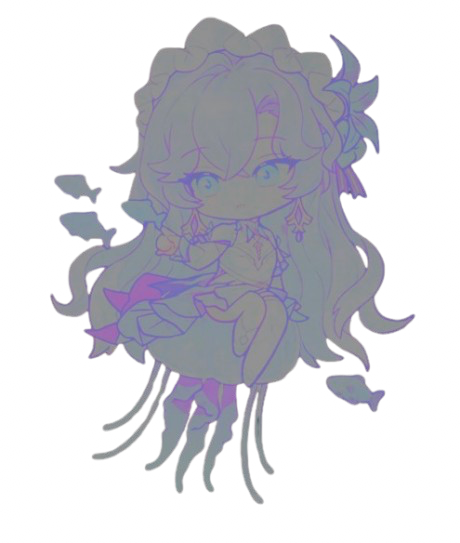

 $${\color{#83929A}I \color{#907BAA}♡ \color{#83929A}my \space \color{#6772BF}trio}$$

  <table>
    <tr>
      <td rowspan="2" align="center" valign="middle">
        
      </td>
      <td align="center" valign="middle">
         $${\color{#92B9B6}Onyx}$$
        
        
      </td>
    </tr>
    <tr>
      <td align="center" valign="middle">
       $${\color{#5B1609}Shark}$$
        
        
      </td>
    </tr>
  </table>

  

    
${\text{\color{#6772BF} Thank you}}$

   
   [pt-walk-of-fame](https://github.com/pt-walk-of-fame)
   [pt-fashion](https://github.com/pt-fashion)
   [title-town](https://github.com/title-town)
   [pt-hall-of-media](https://github.com/pt-hall-of-media)
  
  

 
$${\color{#766BA9}⋆}$$ $${\color{#6371C1}˙}$$ &nbsp;&nbsp;

      

